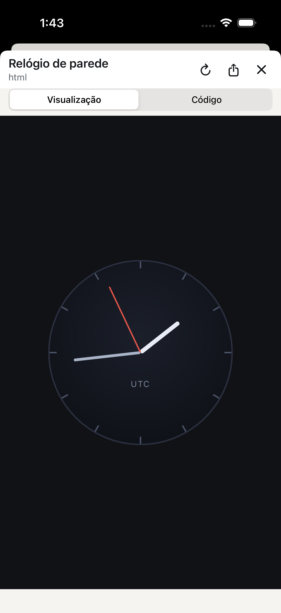
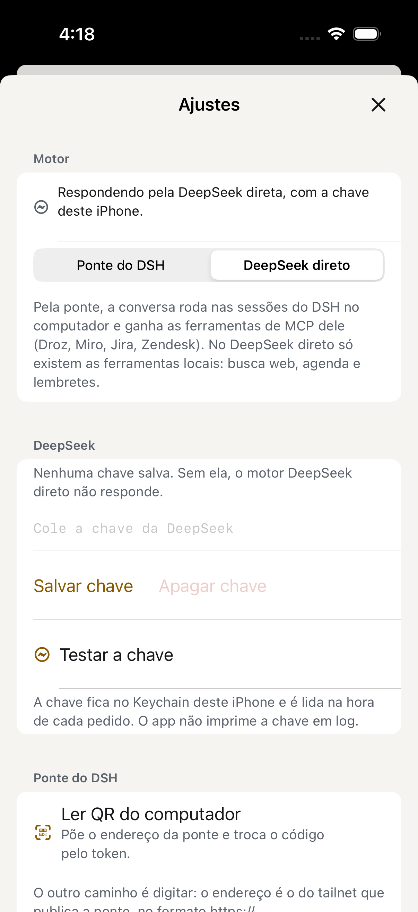

# Entrega: como o app chega no iPhone

Este documento responde a pergunta prática: como o app sai do código e vira ícone na tela
do iPhone, sem um Mac na mão. Ele também registra o que NÃO vai funcionar, para a expectativa
ficar certa desde o começo.

## 1. O que o app é

Aplicativo nativo em SwiftUI para iPhone (iOS 18 ou mais novo), com dois motores de conversa:

| motor | o que usa | o que depende |
|---|---|---|
| Ponte do DSH | a sua instância do DSH, pela `ponte` do tailnet | notebook ligado, Tailscale ativo, token da ponte no cofre do aparelho |
| DeepSeek direto | a API pública da DeepSeek, com a sua chave | internet, chave da API no cofre do aparelho |

O motor da ponte é o que mantém os seus MCPs (Droz, Miro, Jira, Zendesk) disponíveis, porque a
pergunta é respondida pela sua instalação do DSH, e não por um modelo solto. O motor direto
serve quando o notebook está desligado; nele não existe MCP nenhum, só o modelo.

O motor se escolhe em Ajustes, no menu lateral, e a escolha é lida de novo quando a folha
fecha. A ponte só entra em uso quando existe uma sessão do DSH escolhida nesta execução, porque
sem sessão não há para onde mandar a pergunta; a própria tela de Ajustes diz isso.

## 2. Como o app compila

Não existe compilador Swift nesta máquina Windows e não dá para instalar um: compilar para iOS
exige o Xcode, que só roda em macOS. Por isso quem compila é o GitHub Actions, no runner
`macos-15` do repositório privado `VRamses/dsh-ios`.

O caminho é sempre este:

```powershell
# 1. manda o código
git -C "C:\Users\Ramsés\Documents\DSH\dsh-ios" push origin main

# 2. dispara a compilação (o workflow só roda por disparo manual)
gh workflow run ios.yml --repo VRamses/dsh-ios -f ipa=true

# 3. acompanha
gh run list --repo VRamses/dsh-ios --limit 3
gh run watch --repo VRamses/dsh-ios

# 4. baixa o resultado
gh run download --repo VRamses/dsh-ios --name ipa --dir "C:\Users\Ramsés\Downloads\dsh-ipa"
```

O artefato `ipa` traz dois pacotes: `DSH-livre.ipa`, que é o que se instala com conta Apple
gratuita, e `DSH.ipa`, o pacote completo com as duas extensões, que só assina em conta paga. O
artefato `simulador` traz as capturas de tela de cada rota
(`conversa`, `voz`, `ajustes`, `dsh`, `artefato`) e o log de compilação. Quando a compilação
falha, o log com o erro do `xcodebuild` está no artefato `simulador`, em `build-compilacao.log`
ou no próprio resumo do job.

Custo: o runner macOS consome cota de minutos do GitHub Actions, e é o recurso mais caro da
conta. Cada rodada completa gasta de 8 a 15 minutos. Com o repositório privado, esses minutos
saem da cota paga; com o repositório público, macOS é gratuito, mas o código fica exposto.

## 3. O que é o IPA sem assinatura

O workflow compila com `CODE_SIGNING_ALLOWED=NO`, ou seja, gera o binário e empacota em
`Payload/DSH.app` dentro de um `.ipa`, sem assinatura da Apple. Nesse estado o iPhone não
instala o arquivo sozinho: ele precisa ser assinado com um certificado válido para o aparelho.
Quem faz essa assinatura é o programa de instalação no PC, usando a sua conta Apple.

O job `ipa` produz dois pacotes, e a escolha entre eles não é preferência:

| pacote | conteúdo | serve para |
|---|---|---|
| `DSH-livre.ipa` | só o app principal, sem `PlugIns` | conta Apple gratuita, no Sideloadly ou no AltStore |
| `DSH.ipa` | app principal mais `DSHWidget.appex` e `DSHCompartilhar.appex` | conta Apple paga, onde os três assinam |

O pacote com extensão pede três perfis separados, um por bundle, e o App Group que só a conta
paga libera; com conta gratuita o Sideloadly recusa o arquivo ou instala um app que fecha na
abertura. Por isso o `DSH-livre.ipa` sai da `DSH.app` já compilada, com a pasta `PlugIns`
removida antes de zipar. O código do app principal não depende do App Group para nada
essencial: as leituras do armazém compartilhado checam `nil` e simplesmente não entregam o
texto vindo da extensão de compartilhamento, que é o único recurso perdido nessa escolha.

Três caminhos, do mais simples ao mais trabalhoso:

| caminho | o que precisa | validade da assinatura | limitações |
|---|---|---|---|
| AltStore ou SideStore | conta Apple gratuita, um PC com o AltServer rodando na mesma rede de vez em quando | 7 dias, renovação automática pelo AltServer | até 3 apps por aparelho, 10 identificadores por semana |
| Sideloadly | conta Apple gratuita e cabo USB | 7 dias, renovação manual | mais simples de instalar, sem renovação automática |
| Conta de desenvolvedor paga | Apple Developer Program, US$ 99 por ano | 1 ano por perfil | libera App Group, widget, extensão de compartilhamento e TestFlight |

## 4. O limite que precisa ficar claro

Com conta Apple gratuita o iOS não habilita a capacidade de App Group, e sem App Group o widget
e a extensão de compartilhamento não conseguem entregar dados para o app. O app em si continua
funcionando: conversa, voz, artefatos e ajustes são todos dentro do processo principal. O que
quebra é justamente a ponte entre extensões:

- o widget abre as rotas por link, o que funciona sempre;
- o widget mostrar a última conversa e a extensão de compartilhamento mandar texto para o app
  dependem de App Group, então na conta gratuita isso não entrega.

Com conta paga, os três alvos (app, `DSHWidget` e `DSHCompartilhar`) assinam com o mesmo perfil
e o App Group `group.dev.ramses.dsh` passa a valer. O `project.yml` já está preparado para os
três; só falta o perfil pago na hora de assinar.

Outros limites, sem rodeio:

- não há distribuição pela App Store: o app usa API privada de uso pessoal, guarda token no
  cofre do aparelho e não tem política de privacidade publicada, o que a revisão da Apple exige;
- não há notificação push, porque push exige servidor da Apple com certificado de provedor;
- o motor da ponte só funciona no tailnet: fora dele, o app cai no motor direto da DeepSeek
  ou mostra erro de conexão, sem inventar resposta;
- a assinatura gratuita vence a cada 7 dias e o app para de abrir até ser reassinado. Isso é
  regra do iOS, não do projeto.

## 5. Primeira instalação, passo a passo

O que só você pode fazer, porque envolve o seu aparelho e a sua senha: plugar o cabo, tocar
"Confiar" no iPhone, digitar a senha da conta Apple e o código de dois fatores, e autorizar o
perfil de desenvolvedor no aparelho. Nenhum agente faz isso de fora, e a senha da conta Apple
não deve ser entregue a ninguém.

O que o PC precisa ter, no Windows:

| programa | para quê | observação |
|---|---|---|
| iTunes fora da Microsoft Store, ou o app Apple Devices | driver do iPhone e bibliotecas que o AltServer usa | o que já está instalado nesta máquina é só o `Apple Mobile Device Support` que veio com o iCloud, e ele serve para o Sideloadly, não para o AltServer |
| Sideloadly | assinar e instalar uma vez, pelo cabo | caminho mais curto para o primeiro app no aparelho |
| AltServer mais AltStore | renovar a assinatura sozinho a cada 7 dias, pela rede local | exige o iTunes instalado e o AltServer aberto no PC |

Caminho A, Sideloadly (recomendado para a primeira instalação):

1. Baixe o artefato `ipa` da rodada verde e pegue `DSH-livre.ipa`.
2. Instale o Sideloadly no PC e abra. Ele instala os drivers que faltarem.
3. Ligue o iPhone por cabo, toque em "Confiar" no aparelho e informe a senha do aparelho.
4. No iPhone, abra Ajustes, Privacidade e Segurança, Modo de Desenvolvedor e ligue. O iOS 16
   ou mais novo exige isso para abrir app assinado fora da App Store, e o aparelho reinicia.
5. Arraste `DSH-livre.ipa` para a janela do Sideloadly, preencha a conta Apple, e mande
   instalar. Se a conta tiver dois fatores, o programa pede o código na hora.
6. No iPhone, em Ajustes, Geral, VPN e Gerenciamento de Dispositivo, toque no perfil com o seu
   Apple ID e escolha "Confiar". Sem esse passo o app fecha no instante em que abre.
7. Abra o app DSH, vá em Ajustes e cole: a chave da API da DeepSeek e, se for usar a ponte, o
   endereço do tailnet mais o token da ponte.

Caminho B, AltStore (para quem quer renovação automática):

1. Instale o iTunes pelo site da Apple (o da Microsoft Store não serve) e o AltServer no PC.
2. Ligue o iPhone por cabo, confie no computador, e rode o AltServer com o aparelho conectado.
3. No AltServer, escolha "Install AltStore" e informe a conta Apple. Ele instala o AltStore no
   aparelho e usa a mesma conta para assinar os apps que você instalar por ele.
4. Autorize o perfil de desenvolvedor como no passo 6 do caminho A, e ligue o Modo de
   Desenvolvedor como no passo 4.
5. No iPhone, abra o AltStore, aba My Apps, toque em "+" e escolha `DSH-livre.ipa` que você
   mandou para o aparelho (AirDrop, Arquivos ou iCloud Drive).
6. Deixe o AltServer aberto no PC e o iPhone na mesma rede de vez em quando: ele renova a
   assinatura antes dos 7 dias vencerem.

O que o pacote livre perde em relação ao completo: o widget mostrar a última conversa e o
compartilhamento de texto de outro app para o DSH. O ícone do widget continua abrindo as rotas
do app, porque isso é link, não dado compartilhado.

## 6. O que conferir quando algo não abre

| sintoma | causa provável | o que fazer |
|---|---|---|
| app fecha ao abrir | perfil de desenvolvedor não autorizado, ou assinatura vencida | autorizar o perfil nos Ajustes, ou reassinar |
| Sideloadly recusa o arquivo ou o app fecha na abertura com conta gratuita | foi instalado o `DSH.ipa` completo, que tem extensão e App Group | instalar o `DSH-livre.ipa`, que sai na mesma rodada |
| erro de rede no motor da ponte | Tailscale fora, notebook desligado, endereço sem `https://` | conferir o tailnet e o endereço salvo nos Ajustes |
| motor direto responde 401 | chave da API errada ou revogada | colar a chave de novo em Ajustes |
| widget abre mas não mostra conversa | App Group indisponível na conta gratuita | comportamento esperado, ver item 4 |
| captura de tela em branco no artefato | a rota não existe ou o app não chegou a abrir | ler o `console.txt` e o log de compilação |

## 7. Estado do repositório

- `docs/CONTRATO-SWIFT.md`: contrato técnico do time, é a fonte de verdade dos tipos.
- `docs/REFERENCIAS.md`: as referências visuais usadas na interface.
- `docs/ENTREGA.md`: este documento.
- `project.yml`: geração do projeto Xcode com XcodeGen, três alvos.
- `.github/workflows/ios.yml`: a compilação no Actions, com os jobs `simulador` e `ipa`.
- `Fontes/`: o código, separado por assunto (App, Nucleo, Provedores, Compartilhado, Desenho,
  Conversa, Artefatos, Ajustes, Voz, Ferramentas, Plataforma, Widget, Extensao).
- `Recursos/`: os três `Info.plist`, os três `.entitlements` e o catálogo `Assets.xcassets`.

## 8. O ícone do app

O ícone é o sinal de prompt do terminal: um chevron e um cursor em âmbar (`0xE3A33C`, o mesmo
token `Cores.acento` do tema escuro) sobre o fundo `0x0E1013`. Ele é gerado por script, não é
arte de terceiro, para o app não carregar licença de imagem.

- Arquivo: `Recursos/Assets.xcassets/AppIcon.appiconset/icone-1024.png`, 1024x1024, sem alfa.
- Formato do catálogo: ícone único `universal` com `platform: ios`, que é como o Xcode 16
  aceita o tamanho 1024 desde o iOS 18; o Xcode deriva os outros tamanhos.
- Ligado ao alvo por `ASSETCATALOG_COMPILER_APPICON_NAME: AppIcon` no `project.yml`. Sem essa
  linha o catálogo compila, vira `Assets.car` no pacote e o ícone continua vazio na tela do
  iPhone.
- O script que desenha o PNG é `Recursos/icone/gerar-icone.ps1` e roda em Windows PowerShell
  5.1 com `System.Drawing`, sem dependência externa. Ele é ASCII puro de propósito: o
  PowerShell 5.1 lê arquivo com acento como ANSI, e aí o caminho do usuário chega corrompido e
  a gravação falha com acesso negado. Para refazer:
  `powershell -NoProfile -ExecutionPolicy Bypass -File Recursos\icone\gerar-icone.ps1`.

## 9. Prova de que a ponte responde

O caminho do motor da ponte não é promessa: ele foi medido neste notebook, contra o servidor
que está no ar. O app chama exatamente estas rotas, com `Authorization: Bearer <token>`.

| o que foi testado | como | resultado |
|---|---|---|
| endereço padrão do app (`Preferencias.enderecoDaPontePadrao`) | GET `https://desktop-nvl84h2.tail056d02.ts.net:8443/v1/saude` | HTTP 200, `ok: true`, `rotulo: NOTEBOOK`, `maquina: DESKTOP-NVL84H2`, `dsh.aberto: true` |
| contrato que `ServicoPonte.saude()` lê | mesmos campos `ok`, `rotulo`, `maquina`, `dsh.erro` | todos presentes na resposta |
| listagem usada pela tela de sessões | GET `/v1/sessoes` | HTTP 200 com 37 sessões, cada uma com `id`, `titulo`, `rodando`, `turnos` |
| exposição do servidor | `tailscale serve status` | `https://desktop-nvl84h2.tail056d02.ts.net:8443` encaminha para `http://127.0.0.1:43130`, restrito ao tailnet |
| token e limites | `ponte/ponte.json` | `limiteTexto: 8192`, `prefixo: [ponte NOTEBOOK]`, escrita liberada, 120 requisições por minuto |

Duas consequências práticas:

1. O endereço que vem preenchido de fábrica no app é o do notebook, então quem instala e tem
   Tailscale no iPhone só precisa colar o token. Se a ponte for de outra máquina, o endereço
   muda em Ajustes.
2. O Tailscale precisa estar ativo **no iPhone e no computador**, na mesma tailnet. Sem isso o
   endereço não resolve, e é esse o erro que aparece na conversa.

## 10. O que a última rodada do CI prova

A rodada `45552109815` rodou sobre o commit `5f28a33` e terminou com os dois jobs em `success`,
passo por passo. Os números abaixo saíram do artefato baixado e aberto aqui, não do log do
Actions.

| o que | como foi medido | resultado |
|---|---|---|
| job `simulador` | compilar, instalar no iPhone 16 do simulador e capturar as cinco rotas | `success`, 5 capturas de 1206x2622 |
| widget e extensão de compartilhar | passo próprio, `xcodebuild -target DSHWidget` e `-target DSHCompartilhar` | `success`, os dois alvos compilam; antes desta rodada eles não eram compilados por ninguém |
| job `ipa` | compilar para aparelho sem assinatura e empacotar | `success`, `DSH.ipa` com 815.850 bytes |
| binário | `Payload/DSH.app/DSH` dentro do IPA | 3.084.832 bytes |
| catálogo de ícones | `Payload/DSH.app/Assets.car` | 32.735 bytes, ou seja, o catálogo compilou e não saiu vazio |
| ícones derivados | PNGs dentro do pacote | `AppIcon60x60@2x.png` com 2.861 bytes e `AppIcon76x76@2x~ipad.png` com 3.500 bytes |
| `Info.plist` do pacote | lido com `plistlib` | `dev.ramses.dsh`, versão `1.0.0` (build `1`), `MinimumOSVersion` 18.0, `DTXcode` 1640, `DTPlatformVersion` 18.5 |
| ícone ligado ao alvo | `CFBundleIconName` e `CFBundlePrimaryIcon` | `AppIcon`, com `CFBundleIconFiles = [AppIcon60x60]` |

O que cada captura mostra, com o tamanho do arquivo:

| captura | bytes | o que está na tela |
|---|---|---|
| `conversa.png` | 292.523 | o fim de uma resposta, com o bloco de código e dois cartões de artefato: "Relógio de parede" (HTML) e "Relógio em SVG" (SVG) |
| `artefato.png` | 662.544 | o visualizador do artefato HTML rodando o relógio dentro do `WKWebView`, com o ponteiro na hora do relógio do simulador, e o seletor entre Visualização e Código |
| `ajustes.png` | 303.843 | a folha de Ajustes, com o seletor de motor, o cofre da DeepSeek, o endereço e o token da ponte, e as ações de salvar e apagar |
| `dsh.png` | 154.230 | a folha de sessões aberta pela rota `dsh`, no estado sem ponte configurada, que é o estado de fábrica do simulador |
| `voz.png` | 750.103 | a tela de voz com o botão de gravação |

As cinco capturas estão versionadas em `docs/capturas/`, tiradas desta rodada, para não
depender de baixar artefato do Actions para olhar a tela:






O que a rodada **não** prova, para não dar a ela mais peso do que tem:

- nada foi instalado em iPhone físico, e o IPA não é assinado: a rodada mostra que o código
  compila, empacota e roda no simulador, não que o aparelho aceita o arquivo;
- nenhuma captura exercita toque: o app é aberto nas rotas e fotografado, sem digitar, rolar ou
  tocar em botão. Salvar chave, testar conexão e enviar pela ponte continuam verificados só por
  leitura de código;
- a voz capturada é a tela, não o resultado de um reconhecimento: o microfone do simulador é
  permissão dada pelo `simctl`, sem áudio real;
- o widget e a extensão de compartilhar compilam, mas não são executados: o simulador roda só o
  app principal, e o App Group que liga os três exige conta paga do programa de desenvolvedor;
- as capturas são do modo claro do simulador; o modo escuro não é fotografado.

## 11. O que fica aberto

O que está abaixo é conhecido e não escondido. Nenhum item impede usar o app no dia a dia, mas
cada um é uma promessa que o app ainda não cumpre.

| o que | estado | por que não foi feito |
|---|---|---|
| anexo na conversa | a mensagem mostra o ícone e o nome do arquivo, não a miniatura | existe `CartaoDeAnexo` pronto em `Fontes/Artefatos`, e a bolha ainda usa a lista de nomes |
| validar a chave da DeepSeek em Ajustes | só confere o prefixo `sk-` | a API não tem rota de validação de chave, e inventar uma custaria uma chamada paga a cada toque |
| voz automática | a preferência é gravada, mas a tela de voz não a lê | a tela ainda tem botão de gravar e parar manual |
| bloco de código muito longo | cresce sem limite dentro da bolha | cortar com "mostrar mais" mexe no `TextoRico`, e a conversa de demonstração já usa o limite como prova de rolagem |
| primeiro quadro da resposta ao vivo | o recuo pendente aparece a partir do segundo quadro | o streaming chega em pedaços e o primeiro é renderizado antes de haver linha completa |
| criar sessão pela ponte | `POST /v1/sessoes` e `/mensagem` foram verificados só por leitura de código | a rodada do CI não tem tailnet, então não há como exercitar a ponte de dentro do simulador |
| folha do artefato durante a resposta | pode fechar sozinha quando o texto ao vivo vira mensagem gravada | a bolha ao vivo é substituída no fim do stream, e com ela o estado que segurava a folha |
| widget e compartilhamento no iPhone | exigem conta paga do programa de desenvolvedor | os dois alvos usam App Group, que a conta gratuita não libera; com conta gratuita, só o app principal instala |


